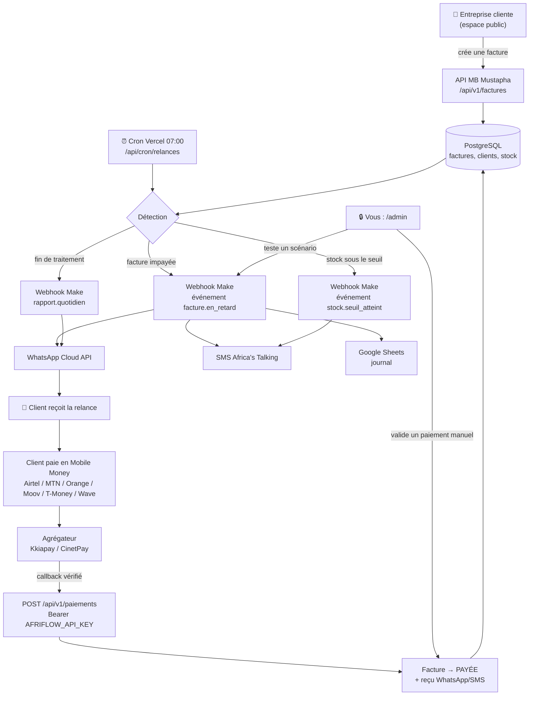
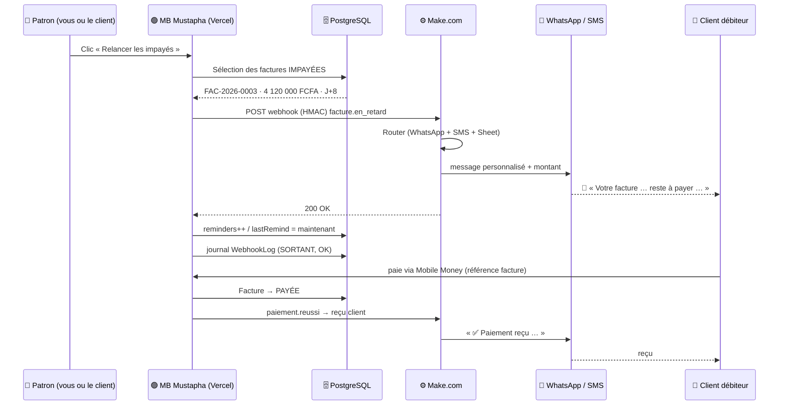
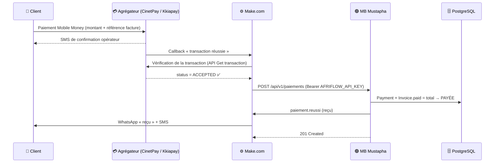

# Schémas de la connexion MB Mustapha ↔ Make.com

Ce document contient le **schéma visuel** (ASCII, lisible partout) et les **diagrammes Mermaid**
(rendus automatiquement par GitHub, Notion, Obsidian, VS Code…).

---

## 1. Schéma ASCII complet (vue en 3 flux)

```
                        ╔══════════════════════════════════════════════════════╗
                        ║        AFRIFLOW  —  APPLICATION  (Vercel)             ║
                        ║                                                       ║
   ENTREPRISES CLIENTES ║  ESPACE PUBLIC               ESPACE PRIVÉ (vous)     ║
   ────────────────►    ║  /tableau-de-bord            /admin                   ║
   Factures, stock,     ║  /factures  /stock           /admin/revenus           ║
   tontines, messages   ║  /tontines  /messages        /admin/make  /clients    ║
                        ║        │                            │                 ║
                        ║        └──────────┬─────────────────┘                 ║
                        ║                   ▼                                   ║
                        ║     API REST /api/v1/...   +   /api/cron/relances 7h  ║
                        ║                   │                                   ║
                        ║   PostgreSQL ◄────┴────► Journal WebhookLog           ║
                        ╚═══════════════════│═══════════════════════════════════╝
                                            │
   ┌────────────────────────────────────────┴──────────────────────────────────────┐
   │                                                                                │
   │  (1) SORTANT                                        (2) ENTRANT                │
   │  POST webhook Make                                  POST /api/webhooks/make   │
   │  x-afriflow-signature: HMAC(secret, corps)           Authorization: Bearer …   │
   │           │                                                  ▲                 │
   │           ▼                                                  │                 │
   │  ┌───────────────────────── M A K E . C O M ──────────────────────────────┐    │
   │  │  Custom webhook ──▶ Router ──▶ WhatsApp Cloud API                      │    │
   │  │                          │                                             │    │
   │  │                          ├──▶ Africa's Talking (SMS)                   │    │
   │  │                          ├──▶ Google Sheets (journal des relances)      │    │
   │  │                          ├──▶ Gmail (facture PDF)                       │    │
   │  │                          └──▶ HTTP (retour vers MB Mustapha)               │    │
   │  └────────────────────────────────────────────────────────────────────────┘    │
   │           │                              │                                     │
   │           ▼                              ▼                                     │
   │   WhatsApp / SMS client            Google Sheet (preuve)                        │
   └────────────────────────────────────────────────────────────────────────────────┘
                                            │
   (3) ENCAISSEMENT                         │
   Client paie par Airtel / MTN / Orange / Moov / T-Money / Wave
        │
        ▼
   Agrégateur (Kkiapay, CinetPay, PayDunya, Flutterwave)
        │  callback "notify_url"
        ├──────────────► /api/webhooks/paiement  (voie directe)
        └──────────────► Make (vérification) ──► /api/v1/paiements (voie robuste)
                                   │
                                   ▼
                    Facture → « PAYÉE »  +  reçu WhatsApp & SMS
```

---

## 2. Diagramme de flux Mermaid



---

## 3. Diagramme de séquence — la relance d'un impayé



---

## 4. Diagramme de séquence — encaissement Mobile Money



---

## 5. Matrice des responsabilités

| Tâche | MB Mustapha | Make.com | Opérateur / Agrégateur |
|---|---|---|---|
| Calcul de la TVA et du total | ✅ | | |
| Détection d'une facture impayée | ✅ | | |
| Rédaction du message de relance | ✅ (payload prêt) | | |
| Envoi WhatsApp / SMS | | ✅ | |
| Journal des relances | ✅ (WebhookLog) | ✅ (Google Sheet) | |
| Vérification d'une transaction | ✅ (si appel direct) | ✅ | ✅ |
| Mise à jour de la facture | ✅ | | |
| Reçu au client | ✅ (déclencheur) | ✅ (envoi) | |
| Validation manuelle (Tchad) | ✅ (`/admin`) | | |

---

## 6. Où trouver chaque schéma dans l'application

| Emplacement | Contenu |
|---|---|
| `/assistant` (page publique) | schéma express + procédure + variables |
| `/admin/make` (espace privé) | schéma des flux + journal réel + tests |
| `/paiements` (espace client) | les 4 étapes d'un encaissement Mobile Money |
| `docs/CONNEXION-MAKE.md` | guide complet, payloads, sécurité, diagnostic |
| `docs/SCHEMA-MAKE.md` | ce document (ASCII + Mermaid) |
